 

 

##  About Me

I'm a **Full Stack Developer** with **3+ years of experience** building web applications and REST APIs with **Node.js, NestJS, React and Next.js** in TypeScript.

I've worked with **multi-tenant architectures**, third-party API integrations, reporting, queues with **Redis & BullMQ**, and deploys with **Docker, AWS and Jenkins**. I've also led a project technically, handling task distribution, code review and mentoring.

I'm interested in **AI and its impact on software development**. I use **Claude Code** and **OpenAI Codex** daily for refactoring, tests and documentation. Outside of programming, I enjoy **following game development** and exploring how games are designed and built.

   
  
   
  <i>And yes, I love Star Wars!</i>

 

##  Tech Stack

<table>
  <tr>
    <td><b>Back-end</b></td>
    <td></td>
  </tr>
  <tr>
    <td><b>Front-end</b></td>
    <td></td>
  </tr>
  <tr>
    <td><b>Database</b></td>
    <td></td>
  </tr>
  <tr>
    <td><b>DevOps & Cloud</b></td>
    <td></td>
  </tr>
  <tr>
    <td><b>Tools</b></td>
    <td></td>
  </tr>
</table>

 

##  Projects

- **Mercado Livre inventory control** (UTFPR) — stock management system integrated with the Mercado Livre API
- **Personal infrastructure** — VPS servers, DNS on Cloudflare and file storage with Cloudflare R2

 

##  Education

  <a href="https://www.utfpr.edu.br/">
    <picture>
      <source media="(prefers-color-scheme: dark)" srcset="./assets/utfpr-logo-white.svg">
      
    </picture>
  </a>
  <h3>UTFPR — Federal University of Technology – Paraná</h3>
  <b>Bachelor's Degree in Software Engineering</b> · 2020 — 2024
   
   Cornélio Procópio, Paraná — Brazil
    
  <b>ETEC</b> — Web Development Technician · 2018 — 2019

 

##  Interests

<table align="center">
  <tr>
    <td align="center" width="200">
       
      <b>AI-powered apps</b>
    </td>
    <td align="center" width="200">
       
      <b>Game development</b>
    </td>
    <td align="center" width="200">
       
      <b>Learning new tech</b>
    </td>
  </tr>
</table>

  Languages: Portuguese (native) · English (upper-intermediate)

 

