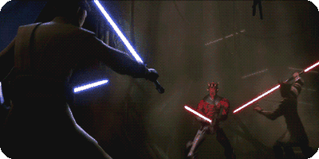

#  Hi, I'm Guilherme

### React • React Native • NestJS Developer

**Web & Mobile Development**

##  About Me

I'm a **React / React Native / NestJS developer** focused on building web and mobile applications. I work full-time as a developer while also building projects for clients with friends outside of work.

I'm interested in **AI and its impact on software development**, experimenting with new ideas and using AI to prototype and build applications.

Outside of programming, I enjoy **following game development** and exploring how games are designed and built.

And yes! I love star wars!

##  Tech Stack

##  Education

### UTFPR — Federal University of Technology – Paraná

**Bachelor's Degree in Software Engineering**

 Cornélio Procópio, Paraná — Brazil

##  Interests

*  AI-powered applications
*  Experimenting with new software ideas
*  Learning and exploring new technologies

##  Contact

